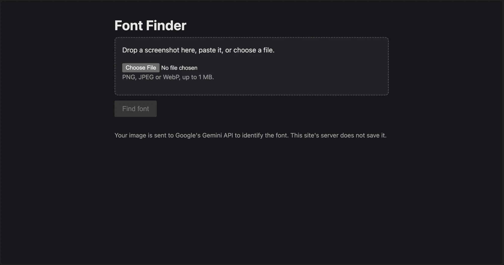
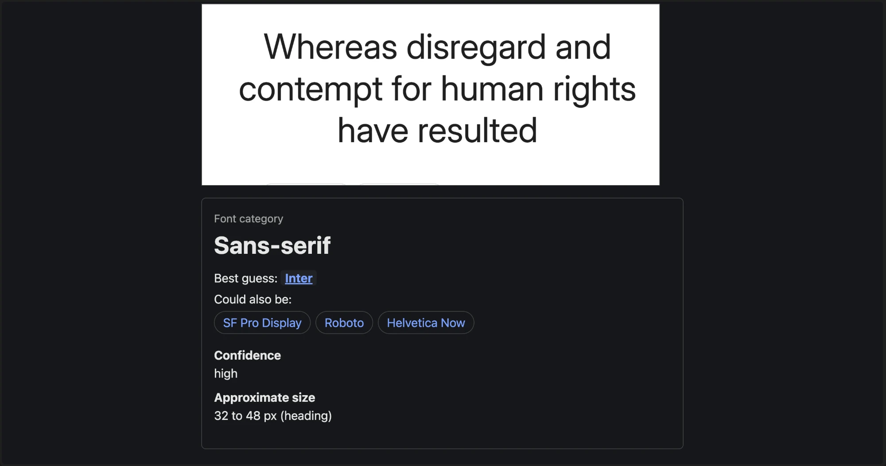
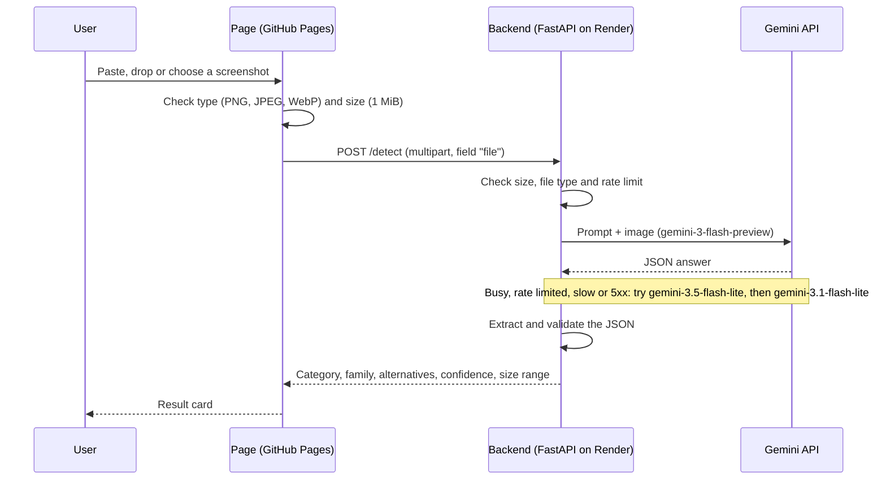

# Font Finder

Upload a screenshot of text and get back the font category, a best guess at the font family with a few alternatives, and an approximate size range.

**Live demo:** coming soon (after deployment).

| Start | Result |
|---|---|
|  |  |

## Features

- **Category first.** The result leads with the font category (serif, sans-serif, monospace, script or display), the part the model gets right most often.
- **Best guess and alternatives.** The likely font family plus two or three similar ones. Each name links to a Google Fonts search.
- **Three ways to add an image.** Paste it (for example straight after taking a screenshot), drag and drop it anywhere on the page, or choose a file.
- **Progress while waiting.** A "Working, 12 s." counter, with a hint after 20 s that the server may be busy.
- **Try another image** button to reset the page.
- **Dark mode** that follows the system setting.

## How it works



The backend exists to keep the Gemini API key off the browser. A key in browser code can be read by anyone with developer tools. Nothing is stored: no database, and uploaded images are never saved or logged on the server.

## Accuracy and limitations

Measured on 5 sample images whose true font is known, each a clear example of its category (13 answers in total):

| | Category right | Family right |
|---|---|---|
| Old prompt, `gemini-3.8-flash` | 4 of 5 | 1 of 5 |
| New prompt, `gemini-3.8-flash` | 3 of 3 | 1 of 3 |
| New prompt, current models | 4 of 5 | 2 of 5 |
| **Total** | **11 of 13** | **4 of 13** |

- **The category is usually right, the font name often is not.** The model is matching shapes visually, not measuring glyphs. That is why the page shows the family as a best guess with alternatives.
- **Confidence is not reliable.** Every answer so far said "high", including the wrong ones.
- **Small test set.** Five clean sample images. Real screenshots are likely harder, and this has not been measured.
- **Size is a rough range, never an exact value.** A screenshot carries no screen density or zoom information, so pixel height cannot be turned into an exact font size. Size accuracy has not been measured.
- **Gemini can be busy.** It sometimes answers 503 "busy". The backend then tries the next model. If all fail, the page says to try again.
- **Speed.** A request takes about 5 to 30 s. On Render's free tier the server also sleeps after 15 minutes without traffic, and the first request after that waits about a minute while it wakes up.
- **Free tier.** The Gemini API key runs on the free tier with a quota, so the service can stop answering for a while if the quota is used up.

## Privacy

- The image is sent to Google's Gemini API to identify the font, and nowhere else.
- This project's server does not save, cache or log images. Uploads are kept in memory only and never written to disk.
- How Google handles content sent to the Gemini API is set by Google's Gemini API terms.

## API

### `POST /detect`

- Body: `multipart/form-data` with one field, `file`.
- Accepted: PNG, JPEG or WebP, up to 1 MiB. The type is checked from the file's first bytes, not from its name or Content-Type header.

Example response (a real answer for the Playfair Display sample):

```json
{
  "family": "Playfair Display",
  "confidence": "high",
  "category": "serif",
  "alternatives": ["Bodoni", "Didot", "DM Serif Display"],
  "sizeMinPx": 60.0,
  "sizeMaxPx": 90.0,
  "sizeLabel": "heading"
}
```

| Field | Type and limits |
|---|---|
| `family` | Text, up to 100 characters. "Unknown" when there is no readable text |
| `confidence` | `"high"`, `"medium"` or `"low"` |
| `category` | `"serif"`, `"sans-serif"`, `"monospace"`, `"script"` or `"display"` |
| `alternatives` | Up to 5 names, each up to 100 characters |
| `sizeMinPx`, `sizeMaxPx` | Numbers from 0 to 1000, `sizeMinPx` never larger than `sizeMaxPx` |
| `sizeLabel` | Text, up to 100 characters, for example "body text" or "heading" |

### Errors

Every error is JSON with a short `detail` message. Raw model text and stack traces are never returned.

| Status | When | `detail` |
|---|---|---|
| 400 | The file is empty | The uploaded file is empty. |
| 413 | The upload is over 1 MiB | File is too large. Maximum is 1 MB. |
| 415 | Not PNG, JPEG or WebP | Only PNG, JPEG and WebP images are accepted. |
| 422 | No `file` field in the request | FastAPI's standard validation error |
| 429 | This backend's rate limit was reached, or no model answered and the last one tried was rate limited | Too many requests. Try again in a minute. |
| 500 | The server has no API key set | Server is missing its API key. |
| 502 | Gemini refused the request, could not be reached, or sent an answer that failed validation | The font service returned an error. / Could not reach the font service. / The font service returned an unexpected reply. |
| 503 | No model answered, and the last one tried was busy | The font service is busy. Try again soon. |
| 504 | No model answered, and the last one tried timed out | The font service timed out. Try again. |

## Security

- **API key on the server only.** Read from the `GEMINI_API_KEY` environment variable and sent to Google in the `x-goog-api-key` header, never in a URL. It is never in the page or the repository.
- **CORS allowlist.** Only the origins in `ALLOWED_ORIGINS` may call the API from a browser. Empty by default, never `*`.
- **Rate limit.** 5 requests per minute per IP address and 30 per minute in total, checked before Gemini is called. The Gemini key also has a quota cap in Google's console.
- **Upload limit by byte count.** A middleware counts the request body as it arrives and stops at 1 MiB, so oversized uploads are never fully received and images never touch disk. This also covers uploads without a `Content-Length` header.
- **File type from content.** The first bytes of the file decide whether it is PNG, JPEG or WebP.
- **The model's answer is untrusted.** It is parsed and validated with Pydantic, with length and range limits, before anything is returned.
- **No public API docs.** `/docs`, `/redoc` and `/openapi.json` are switched off.
- **Safe page.** The page writes every value with `textContent`, never as HTML. Every link is a fixed `https://fonts.google.com/?query=` plus the encoded name, and opens with `rel="noopener noreferrer"`.


## Tests

```bash
python3 -m pytest
```

81 tests, none of which call the real Gemini API:

- `backend/tests/test_detect.py` (14): upload checks, the 1 MiB limit with and without `Content-Length`, and uploads staying in memory.
- `backend/tests/test_parser.py` (37): extracting and validating the model's JSON, including code fences, missing keys, wrong types and the length and range limits.
- `backend/tests/test_gemini_fallback.py` (17): the model order and timeouts, each reason to try the next model, and the errors that stop at once.
- `backend/tests/test_security.py` (13): the rate limiter, API docs switched off, and CORS.

## Project structure

```
.
├── index.html                  Frontend: one static page, vanilla JS, no build step
├── backend/
│   ├── main.py                 FastAPI app: /detect, upload checks, rate limit, Gemini call, validation
│   ├── requirements.txt        Python dependencies
│   └── tests/                  pytest tests
├── images/                     Screenshots used in this README
├── reference/test.py           Original standalone Gemini test script, kept as a reference
├── .env.example                Example environment variables (placeholders only)
├── PROGRESS.md                 Work log per task
├── ISSUES.md                   Known issues and their status
└── TASKS.md                    Task list
```

## Deployment

Planned, to be confirmed once deployed:

- **Backend on Render (free tier).** Start command from the `backend` folder: `uvicorn main:app --host 0.0.0.0 --port $PORT`. Environment variables in the Render dashboard: `GEMINI_API_KEY`, and `ALLOWED_ORIGINS` set to exactly the GitHub Pages origin, for example `https://<user>.github.io`.
- **Frontend on GitHub Pages** from the repository root. Before publishing, set `API_URL` at the top of the script in `index.html` to the https Render URL.

## License

MIT, see `LICENSE`.
