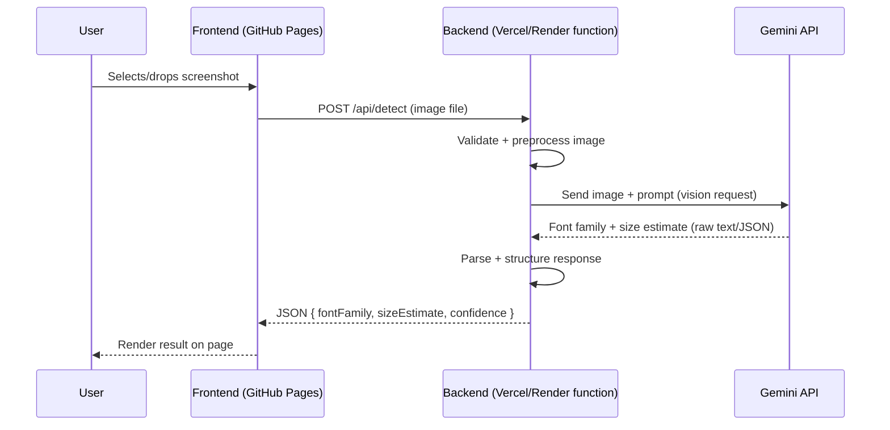

# Font Finder

Upload a screenshot of some text and get back the font family (and an approximate size range) it's using.

## Stack (minimal frontend, no data storage)

- **Frontend:** A single static `index.html` with vanilla JS — file input, fetch call, result display. No framework, no build step. Hosted directly on GitHub Pages.
- **Backend:** Vercel serverless function or Render web service — exists purely to keep the Gemini API key off the client. The frontend can't call Gemini directly, since anyone could open devtools and steal an embedded key.
- **AI layer:** Google Gemini API (free tier, vision-capable)

No database. Every request is stateless — nothing is stored server-side.

## How it works

1. User selects/drops a screenshot on the page.
2. Frontend sends the image to the backend (`POST /api/detect`).
3. Backend validates/preprocesses the image, then forwards it to Gemini with a prompt asking for the font family and an estimated size range.
4. Gemini returns a raw response; the backend parses it into structured JSON.
5. Backend returns the result to the frontend, which renders it on the page.



## Request/response shape

**Request** (`POST /api/detect`):
```json
{
  "image": "<base64-encoded screenshot>"
}
```

**Response**:
```json
{
  "fontFamily": "Helvetica",
  "sizeEstimate": "24-32px (heading range)",
  "confidence": "medium",
  "note": "Size is a relative estimate, not exact — screenshots don't carry DPI info."
}
```

## Limitations

- **Font family detection** is a best-effort visual match. It performs well on common web/system fonts (Helvetica, Roboto, Inter, Times New Roman, etc.) and less reliably on similar-looking fonts or obscure/custom typefaces, since the model is pattern-matching visually rather than doing true glyph-level feature extraction.
- **Font size detection is approximate, not exact.** Pixel height in a screenshot doesn't map to a real point size without knowing the source DPI, browser zoom, or image resolution. Treat size output as a relative estimate, not a precise measurement.
- This project runs on free-tier infrastructure (Gemini free tier, Render/Vercel free tier). Expect rate limits and, on Render, a cold-start delay of 30–50 seconds after idle periods.


No frontend build step required — `index.html` can be opened directly or served as-is via GitHub Pages.


## Deployment

- Frontend: GitHub Pages (just push `index.html`)
- Backend: Vercel serverless function or Render web service
- Set `GEMINI_API_KEY` as an environment variable on whichever platform hosts the backend